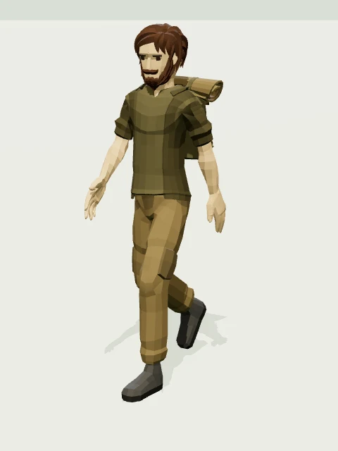
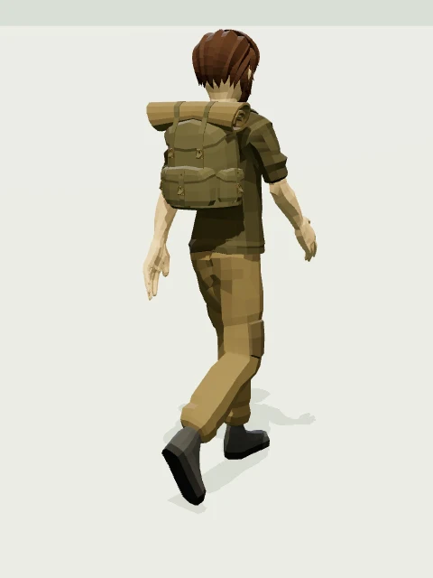

# Expedition character acquisition

Researched and acquired on **2026-10-23**. This handoff changes only this document and `public/expedition/character/`; it does not integrate a character into the app.

## Selected asset

**Adventurer by Quaternius**, the bearded male with a hiking backpack, straps, pockets, buckles, and rolled bedroll. This is an artist-authored, fully dimensional skinned character with adult proportions, modeled hands, hair, beard, eyes, clothing, and boots. It has 24 embedded animations, including a complete walk cycle, idle, run, interaction, and wave. No separate retargeting, backpack construction, account, purchase, textures, or animation service is needed.

This is the best feasible ready-to-use **open-license** match found, not a claim of photorealism. Its surfaces are visibly faceted low-poly. It has skeletal body gestures but **no facial animation or morph targets**. The face remains fixed during idle/wave. For the portfolio, use dimensional lighting, soft shadows, matte cloth/skin, and an oblique view that reveals the pack. Do not add sketch outlines.

- [Specific asset listing and CC0 grant](https://poly.pizza/m/5EGWBMpuXq), published 2022-02-22.
- [Creator's Ultimate Modular Men pack](https://quaternius.com/packs/ultimatemodularcharacters.html), February 2022; the page also identifies this pack as CC0 with 24 animations.
- [Exact original GLB download](https://static.poly.pizza/bbe369ee-a686-42c7-adad-14356f5f2f15.glb).
- Repository asset: [`../public/expedition/character/adventurer.glb`](../public/expedition/character/adventurer.glb).
- Runtime URL: **`/expedition/character/adventurer.glb`**. If deployed below a base path, prefix with `import.meta.env.BASE_URL`.




The previews are local Three.js renders of the downloaded binary at `CharacterArmature|Walk`, time `0.18` seconds. They use the optional material settings below. The rear view turns the whole model by π radians. The original GLB has not been modified.

## License and provenance

**CC0 1.0 Universal / `CC0-1.0`**, as explicitly attached to this specific 2022 asset on Poly Pizza. Commercial use, modification, and redistribution are permitted by [CC0](https://creativecommons.org/publicdomain/zero/1.0/). Attribution is optional; suggested credit:

> “Adventurer” by Quaternius, via [Poly Pizza](https://poly.pizza/m/5EGWBMpuXq), CC0 1.0.

The download is byte-for-byte original: **1,944,116 bytes** (1.854 MiB), SHA-256:

```text
4a8639cd8eee9d8a150464edc25eb0536ced464790704a64e40c8620d99f66db
```

Preserved alongside the GLB:

- `provenance.json`: source/download URLs, retrieval date, exact source IDs, source licensing metadata, original listing date, file size, and checksum.
- `LICENSE.txt`: asset credit and license scope.
- `CC0-1.0.txt`: full unmodified Creative Commons legal code, downloaded from [the official plain-text endpoint](https://creativecommons.org/publicdomain/zero/1.0/legalcode.txt).
- `inspection.json`: measured bounds, all original nodes and transforms, Three.js node names, skins, mesh/material inventory, full animation names/durations, and walk-cycle measurements.
- `validation.json`: Khronos glTF Validator report for the original binary.
- `preview-front.webp`, `preview-back.webp`: locally rendered inspection images.

**License scope matters:** [Quaternius's general license page](https://quaternius.com/license.html) now presents QAL v1.0 dated 2026-08-28, with restrictions on standalone asset redistribution. This acquisition relies on the **specific, still-published CC0 grant for this 2022 release**, corroborated by the creator's pack page; it does not label all current Quaternius downloads CC0. The [CC0 waiver is permanent and irrevocable](https://creativecommons.org/publicdomain/zero/1.0/legalcode.en). Keep the asset-specific provenance with the binary rather than replacing it with a general statement about the creator's library.

## Research and rejected alternatives

Searches included Internet Archive's live search/metadata APIs, creator sites, Kenney, Quaternius, Poly Pizza, OpenGameArt search results, and CC-BY Sketchfab listings. The decision prioritizes an actual obtainable binary with a pack and usable animation over a promising thumbnail.

| Source/candidate | What was verified | Decision |
| --- | --- | --- |
| [Internet Archive: Quaternius search](https://archive.org/advancedsearch.php?q=creator%3AQuaternius&output=json) | Returned nine archived packs, including Platformer, Zombie Apocalypse, Cyberpunk, Cube World, and environment packs. Also searched `(adventurer OR backpack OR explorer) AND (glb OR gltf OR "3d model")`; many results were unrelated software or printable models. | Archive was actually searched, not treated as a synonym for general web search. No stronger human backpack character was established there. |
| [Archive: Zombie Apocalypse Kit](https://archive.org/details/zombie-apocalypse-kit), [metadata](https://archive.org/metadata/zombie-apocalypse-kit) | Downloaded and inspected the 40,920,865-byte ZIP `Zombie Apocalypse Kit - March 2024-20240909T025008Z-001.zip` in temporary storage. Its included `License.txt` grants CC0, although its heading says Ultimate Platformer Pack. Inspected `Characters_Matt.gltf` / `Characters_Sam.gltf`: rigged with 20 clips including `Idle`, `Walk`, and `Wave`. Preview shows exaggerated heads, cartoon survivor styling, weapons, and zombies. | More cartoon-like and less suited to the requested adult adventurer. Not added to this repository. |
| [Archive: Platformer Game Kit](https://archive.org/details/platformer-game-kit), [metadata](https://archive.org/metadata/platformer-game-kit) | Live metadata identifies a platformer character with 18 animations and a 19,980,466-byte ZIP. Item-level license field was absent. | Less appropriate platformer styling; not downloaded or assumed licensed solely from search results. |
| [Archive: Cyberpunk Game Kit](https://archive.org/details/cyberpunk-game-kit-quaternius), [metadata](https://archive.org/metadata/cyberpunk-game-kit-quaternius) | Live metadata identifies Quaternius, CC0, and an animated sci-fi character kit. | Sci-fi visual theme mismatches the hiking brief. |
| [Kenney Animated Characters Survivors](https://kenney.nl/assets/animated-characters-survivors), [import guide](https://kenney.nl/knowledge-base/game-assets-3d/importing-characters-and-animations) | Creator page explicitly grants CC0. The series uses simple low-poly bodies/skin images; its guide describes FBX models and separate animation imports. | Less facial/clothing detail and more preparation than the selected complete GLB. |
| [KayKit Adventurers](https://kaylousberg.itch.io/kaykit-adventurers) | Creator offers textured, rigged dungeon characters under CC0 with a separate character animation library. | Appealing but strongly stylized dungeon/chibi proportions, weaker fit for this brief. |
| [Quaternius female Adventurer](https://poly.pizza/m/ZwF0K7WBmu) | Downloaded original GLB into temporary storage and parsed 24 animations, including walk and idle; specific listing is CC0. Viewed its model preview. | Feasible alternative. Selected the bearded model with a clearly separate modeled backpack and the strongest match to the requested hiking silhouette. |
| [Blake by ManNeko](https://manneko.itch.io/blake-the-adventurer-free-low-poly-character) | Creator offers a 16 MB animated GLB with more natural facial detail. Viewed preview and downloaded the bundled usage license through itch.io's free download flow. It permits project use but prohibits standalone redistribution of original assets/animations; derivatives may be shared only within final projects. The previewed character also lacks a hiking pack. | Stronger realism, but not the requested CC0/CC-BY acquisition and requires an added pack. Not added to the repository. |
| [CC-BY Blake on Sketchfab](https://sketchfab.com/3d-models/blake-the-adventurer-version-3-0196f2f4aa6d41a4af15ddb204eaef34), [CC-BY MadTroll adventurer](https://sketchfab.com/3d-models/low-poly-adventurer-4374b3f0aff5479fa94cbefb547a8ab0) | Author listings advertise downloadable rigged characters with CC Attribution. The MadTroll listing describes a character/rig, without establishing included walk/idle clips. | Researched as alternatives; did not establish a better complete backpack + walk/idle GLB acquisition from them. No viewer-cache extraction or attribution-free assumption. |

## Exact binary and Three.js details

Measured with the repository's **Three.js r186** `GLTFLoader`; glTF asset generator is `FBX2glTF v0.9.7`, format glTF 2.0.

| Property | Actual downloaded binary |
| --- | --- |
| Scene | Raw glTF `Root Scene`; Three.js name `Root_Scene` |
| Root hierarchy | `Root_Scene` → `RootNode` → `CharacterArmature` → `Root` → `Body` → `Hips` → `Abdomen` → `Torso` → `Chest` → `Neck` → `Head` |
| Other `RootNode` children | `Adventurer_Feet`, `Adventurer_Legs`, `Adventurer_Body`, `Adventurer_Head`, `Backpack` |
| Source nodes / skins | 86 nodes; 5 skins with 62 joints each, referencing the same rig |
| Render geometry | **10,198 triangles**, **20,569 vertices**, 15 material primitives / Three.js `SkinnedMesh` children |
| Materials | 11: `Black`, `Grey`, `Brown2`, `Brown`, `Green`, `LightGreen`, `Skin`, `Eyebrows`, `Eye`, `Hair`, `Gold` |
| Textures / dependencies | None. No external `.bin`, image, Draco, Meshopt, KTX2, or decoder required. |
| Facial animation | None; no morph targets |
| Coordinate convention | Already Y-up, facing **+Z**; backpack behind the torso on −Z |
| Rest bounds at outer scale 1 | min `[-0.273998085, -0.002485152, -0.248433961]`; max `[0.330943296, 1.824466268, 0.471951437]` |
| Rest dimensions | width `0.604941382`, height `1.826951420`, depth `0.720385398` |

The listing reports 3,388 triangles; that does **not** match the downloaded GLB. Use the measured binary figures above for performance budgets. A shadow pass repeats the geometry draw; the 15 calls describe the character's ordinary pass, excluding ground/environment.

### Node lookup and mesh names

Use `model.getObjectByName('Backpack')` for the entire pack group. Its children are `Backpack_1` through `Backpack_4`, already skinned; keep them in the loaded hierarchy. The pack follows `Chest` and needs no attachment code. `inspection.json` contains the full source node and skin inventory.

`GLTFLoader` splits each source mesh into material primitives:

| Source group | Actual Three.js skinned children | Materials in that order |
| --- | --- | --- |
| `Adventurer_Feet` | `Adventurer_Feet_1`, `Adventurer_Feet_2` | `Black`, `Grey` |
| `Adventurer_Legs` | `Adventurer_Legs_1`, `Adventurer_Legs_2` | `Brown2`, `Brown` |
| `Adventurer_Body` | `Adventurer_Body_1` … `Adventurer_Body_3` | `Green`, `LightGreen`, `Skin` |
| `Adventurer_Head` | `Adventurer_Head_1` … `Adventurer_Head_4` | `Skin`, `Eyebrows`, `Eye`, `Hair` |
| `Backpack` | `Backpack_1` … `Backpack_4` | `Brown`, `Green`, `LightGreen`, `Gold` |

Source bone names contain periods, e.g. `UpperLeg.L`, `Foot.R`, `Wrist.L`. Three.js sanitizes these to **`UpperLegL`**, **`FootR`**, **`WristL`**. `Root`, `Body`, `Chest`, and `Head` are unchanged. Use the `threeName` field in `inspection.json` for runtime lookup; do not guess Mixamo names.

### Scale, ground contact, and locomotion

- **Outer scale 1 is already about 1.83 m tall** when a world unit represents a meter. Do not apply a `0.01` conversion. To target an exact rest-bounds height of 1.80 units, use outer scale **`0.9852478728299693`**. In general use `targetHeight / 1.8269514196765364`.
- The imported armature/body mesh nodes contain a scale of `100` and compensating −90° X rotations. `Backpack` has source scale `26.0768852233887` and its own authored transform. These are part of the FBX conversion and skin binding. Preserve them; resize/turn a wrapper containing the **entire scene**.
- The rest pose's lowest point is `−0.002485152`. Across **81 samples of Walk**, the lowest point is `−0.018511590`; a starting sole clearance of **`0.02 * scale`** above the terrain avoids flat-ground penetration with tiny clearance. For sloping terrain, use terrain sampling/foot contact logic; the GLB supplies no terrain IK.
- `CharacterArmature|Walk` lasts **`1.3333333730697632` s**. It is an **in-place** two-step cycle: the root starts and ends at `[0, ~0, 0.0722886504]` in loaded world coordinates and does not advance. Body sway and vertical bob are intentional. Move the wrapper along the route independently; preserve the animated bone translations.
- Start with route speed around `0.9–1.1 * scale` world units/second at `action.timeScale = 1`, then tune against visible foot sliding. That speed is an integration starting point, not authored root-motion data.
- To face a route going **+X**, set the outer wrapper's `rotation.y = Math.PI / 2`. Route position belongs on the wrapper. The mixer belongs on the loaded model.
- Start idle immediately after loading. Crossfade idle/walk over roughly `0.18–0.25` s. Pause/stop walking when the route stops; honor reduced motion in the integrator.
- Clone multiple instances with `SkeletonUtils.clone(model)`, giving each a separate mixer; plain scene cloning can share skeleton state.

### Animation names, durations, and tracks

Names below are exact, including the pipe and the source spelling `HitRecieve`. Keep the full string when using `AnimationClip.findByName`. Durations below are rounded to six decimals; `inspection.json` preserves full precision.

| Clip | Seconds | Tracks |
| --- | ---: | ---: |
| `CharacterArmature|Death` | 1.041667 | 30 |
| `CharacterArmature|Gun_Shoot` | 0.583333 | 34 |
| `CharacterArmature|HitRecieve` | 0.541667 | 18 |
| `CharacterArmature|HitRecieve_2` | 0.541667 | 19 |
| `CharacterArmature|Idle` | 1.666667 | 21 |
| `CharacterArmature|Idle_Gun` | 1.666667 | 35 |
| `CharacterArmature|Idle_Gun_Pointing` | 1.666667 | 35 |
| `CharacterArmature|Idle_Gun_Shoot` | 0.666667 | 38 |
| `CharacterArmature|Idle_Neutral` | 1.666667 | 29 |
| `CharacterArmature|Idle_Sword` | 1.666667 | 34 |
| `CharacterArmature|Interact` | 1.250000 | 23 |
| `CharacterArmature|Kick_Left` | 0.916667 | 54 |
| `CharacterArmature|Kick_Right` | 0.916667 | 56 |
| `CharacterArmature|Punch_Left` | 0.833333 | 55 |
| `CharacterArmature|Punch_Right` | 0.833333 | 56 |
| `CharacterArmature|Roll` | 1.333333 | 58 |
| `CharacterArmature|Run` | 0.791667 | 54 |
| `CharacterArmature|Run_Back` | 0.833333 | 54 |
| `CharacterArmature|Run_Left` | 0.791667 | 55 |
| `CharacterArmature|Run_Right` | 0.791667 | 56 |
| `CharacterArmature|Run_Shoot` | 0.833333 | 54 |
| `CharacterArmature|Sword_Slash` | 1.000000 | 37 |
| `CharacterArmature|Walk` | 1.333333 | 37 |
| `CharacterArmature|Wave` | 1.666667 | 23 |

Recommended portfolio clips: `Idle` (subtle breathing), `Walk` (travel), `Run` (optional faster travel), `Wave` (greeting), and `Interact` (landmark). Loop idle/walk/run; make wave/interaction one-shot with `LoopOnce` and `clampWhenFinished = true`. The binary includes combat clips for completeness, but the portfolio does not need to use them. No separate weapon geometry is loaded with this character.

### Integrator example (documentation only)

```js
import * as THREE from 'three';
import { GLTFLoader } from 'three/addons/loaders/GLTFLoader.js';

const gltf = await new GLTFLoader().loadAsync(
  `${import.meta.env.BASE_URL}expedition/character/adventurer.glb`,
);
const model = gltf.scene;
const actor = new THREE.Group();
const scale = 1; // ~1.83 units tall; use 0.9852478728299693 for 1.80.
actor.scale.setScalar(scale);
actor.rotation.y = Math.PI / 2; // +Z source facing -> +X route facing.
actor.add(model);
scene.add(actor);

// Optional matte conversion used for the included previews.
// Materials are reused across primitives, so these assignments are idempotent.
model.traverse((object) => {
  if (!object.isMesh) return;
  object.castShadow = true;
  object.receiveShadow = true;
  const materials = Array.isArray(object.material)
    ? object.material : [object.material];
  for (const material of materials) {
    material.metalness = material.name === 'Gold' ? 0.65 : 0;
    material.roughness = material.name === 'Gold' ? 0.4 : 0.86;
  }
});

const mixer = new THREE.AnimationMixer(model);
const idle = mixer.clipAction(THREE.AnimationClip.findByName(
  gltf.animations, 'CharacterArmature|Idle',
));
const walk = mixer.clipAction(THREE.AnimationClip.findByName(
  gltf.animations, 'CharacterArmature|Walk',
));
idle.play();
let moving = false;

function setMoving(nextMoving) {
  if (nextMoving === moving) return;
  const previous = moving ? walk : idle;
  const next = nextMoving ? walk : idle;
  next.reset().setEffectiveWeight(1).play();
  previous.crossFadeTo(next, 0.2, false);
  moving = nextMoving;
}

// In the integrator's existing frame loop:
// actor.position.set(routeX, terrainHeight + 0.02 * scale, routeZ);
// setMoving(routeIsAdvancing);
// mixer.update(dt);
```

Source materials all use metallic `0.4`, roughness `0.415087103843689`, inherited from FBX/Phong conversion. They are not physically authored cloth/skin values. The optional conversion makes the model fit a naturally shaded miniature world without altering the asset file. Previews used ACES filmic tone mapping, exposure `1.2`, hemisphere fill, directional key/rim lights, and soft shadow mapping. The portfolio should tune lighting to its scene.

## Verification and known limitations

- Original GLB magic/header/chunk lengths and all animation/skin data parsed successfully; hash and byte size recorded.
- Parsed the entire file with Three.js r186 `GLTFLoader`, enumerated 15 skinned mesh primitives, 24 clips, and 11 materials. Sampled every clip at five times without loader/mixer errors.
- Khronos `gltf-validator` **2.0.0-dev.3.10**: **0 errors, 10 warnings, 33 informational messages**. `validation.json` preserves all messages. The ten warnings are `NODE_SKINNED_MESH_NON_ROOT` and `NODE_SKINNED_MESH_LOCAL_TRANSFORMS`, once each for the five original skinned nodes. They describe the source FBX hierarchy/transforms. Three.js playback was checked with that original hierarchy preserved. Informational messages cover unused UVs and empty end bones. This is not a warning-free or universally engine-validated asset.
- Measured 81 samples of Walk with a clamped last frame: no cumulative root travel; a sampled boot vertex differs by about `6.30e-9` units between first/last frames. Sampled a backpack vertex through the same cycle to confirm attachment/motion. These checks establish loop/rig operation, not motion-capture quality or terrain contact.
- Rendered all 24 clips at five times each, then ran idle/walk for 240 sequential frames in local Chromium using the repository's Three.js: zero browser errors or failed requests. Separately inspected walk front/rear, idle, wave, and original versus matte materials. Verified visible leg/arm articulation, attached pack/bedroll, and shadows. The T3 collaborative browser twice timed out taking a snapshot, so local Chromium was used for visual inspection.
- No facial rig, blendshapes, terrain IK, authored travel speed, or root-motion locomotion is supplied. Walk is a conventional authored game cycle; foot sliding depends on matching route speed. The model remains visibly low-poly in close-up.
- App integration, mobile scene performance, whole-portfolio lighting, terrain alignment, and final visual acceptance remain the integrator's work. No app/source files were edited for this acquisition.
